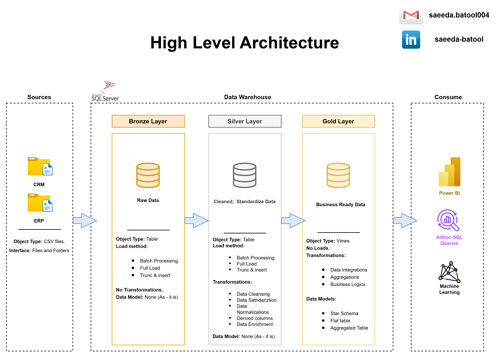

# Data Warehouse and Analytics Project

Welcome to the **Data Warehouse and Analytics Project** repository! 🚀
This project walks through building a complete data warehouse and turning its data into useful business insights. It was created as a portfolio project and follows widely used best practices in data engineering and analytics.

---

## 🏗️ Data Architecture

The project is built on the **Medallion Architecture**, which organises data into **Bronze**, **Silver** and **Gold** layers:



1. **Bronze Layer**: Keeps the raw data exactly as it arrives from the source systems. The data is loaded from CSV files into a SQL Server database.
2. **Silver Layer**: Cleans, standardises and normalises the data so it is ready for analysis.
3. **Gold Layer**: Contains business-ready data modelled as a star schema, built for reporting and analytics.

---

## 📖 Project Overview

The project covers the following areas:

1. **Data Architecture**: Designing a modern data warehouse using the Bronze, Silver and Gold layers of the Medallion Architecture.
2. **ETL Pipelines**: Extracting data from the source systems, transforming it, and loading it into the warehouse.
3. **Data Modeling**: Creating fact and dimension tables that are optimised for analytical queries.
4. **Analytics & Reporting**: Writing SQL-based reports and dashboards that produce actionable insights.

🎯 This repository is a useful resource for professionals and students who want to demonstrate skills in:
- SQL Development
- Data Architecture
- Data Engineering
- ETL Pipeline Development
- Data Modeling
- Data Analytics

---

## 🛠️ Useful Links & Tools

Everything used in this project is free!
- **[Datasets](datasets/):** The project dataset, provided as CSV files.
- **[SQL Server Express](https://www.microsoft.com/en-us/sql-server/sql-server-downloads):** A lightweight server for hosting your SQL database.
- **[SQL Server Management Studio (SSMS)](https://learn.microsoft.com/en-us/sql/ssms/download-sql-server-management-studio-ssms?view=sql-server-ver16):** A graphical tool for managing and working with databases.
- **[Git Repository](https://github.com/):** Create a GitHub account and repository to version, manage and collaborate on your code.
- **[DrawIO](https://www.drawio.com/):** Used to design data architecture, models, flows and diagrams.
- **[Notion](https://www.notion.com/):** An all-in-one tool for organising and managing the project.
- **[Notion Project Steps](https://thankful-pangolin-2ca.notion.site/SQL-Data-Warehouse-Project-16ed041640ef80489667cfe2f380b269?pvs=4):** All project phases and tasks in one place.

---

## 🚀 Project Requirements

### Building the Data Warehouse (Data Engineering)

#### Objective
Build a modern data warehouse on SQL Server that brings sales data together in one place, supporting analytical reporting and better decision-making.

#### Specifications
- **Data Sources**: Load data from two source systems (ERP and CRM), both provided as CSV files.
- **Data Quality**: Clean the data and fix any quality issues before analysis.
- **Integration**: Merge both sources into one easy-to-use data model designed for analytical queries.
- **Scope**: Work with the latest dataset only; keeping historical versions of data is not required.
- **Documentation**: Document the data model clearly so that both business stakeholders and analytics teams can understand it.

---

### BI: Analytics & Reporting (Data Analysis)

#### Objective
Build SQL-based analytics that give detailed insights into:
- **Customer Behavior**
- **Product Performance**
- **Sales Trends**

These insights give stakeholders the key business metrics they need to make strategic decisions.
---

## 📂 Repository Structure

```
data-warehouse-project/
│
├── datasets/                           # Raw project datasets (ERP and CRM data)
│
├── docs/                               # Project documentation and architecture details
│   ├── etl.drawio                      # Draw.io file showing the different ETL techniques and methods
│   ├── data_architecture.drawio        # Draw.io file showing the project architecture
│   ├── data_catalog.md                 # Dataset catalog with field descriptions and metadata
│   ├── data_flow.drawio                # Draw.io file for the data flow diagram
│   ├── data_models.drawio              # Draw.io file for the data models (star schema)
│   ├── naming-conventions.md           # Naming guidelines for tables, columns and files
│
├── scripts/                            # SQL scripts for ETL and transformations
│   ├── bronze/                         # Scripts for extracting and loading raw data
│   ├── silver/                         # Scripts for cleaning and transforming data
│   ├── gold/                           # Scripts for creating the analytical models
│
├── tests/                              # Test scripts and data quality checks
│
├── README.md                           # Project overview and instructions
├── LICENSE                             # License information for the repository
├── .gitignore                          # Files and folders ignored by Git
└── requirements.txt                    # Project dependencies and requirements
```

---

## 🛡️ License

This project is licensed under the [MIT License](LICENSE). You are free to use, modify and share it, as long as you give proper attribution.

## About Me

Hi there! 👋 I'm Saeeda Batool

🎓 I recently completed my MS in Advanced Computer Science with Artificial Intelligence.

💻 I'm an IT professional passionate about technology, AI, Data Analytics and continuous learning.

🚀 I love exploring new technologies, sharing knowledge, and building innovative solutions.

✨ My Mission: Learn, Create, Inspire, and Share Knowledge!

[](https://linkedin.com/in/saeeda-batool)
